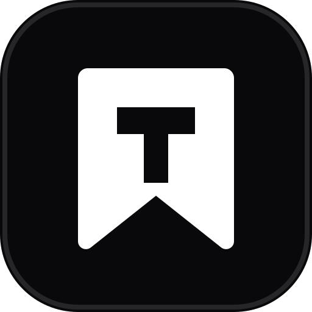

<div align="center">
  

  # Tessera
  *Local-first, Zero-Knowledge End-to-End Encrypted Bookmark Manager*

  [](https://github.com/BhaveshP888/Tessera-Auth/actions)
  [](https://github.com/BhaveshP888/Tessera-Auth)
  [-3178c6?style=flat-square)](https://www.typescriptlang.org/)
  [](https://bun.sh)
  [](https://tessera-auth.vercel.app/)

  [Features](#features) • [Architecture](#architecture) • [Quick Start](#quick-start) • [Browser Extension](#browser-extension) • [Deployment](#deployment) • [Testing](#testing)

</div>

---

Tessera is an offline-capable, local-first bookmark manager engineered for speed, privacy, and absolute user sovereignty. It combines cryptographic Zero-Knowledge sync, an isolated private vault, hardware-accelerated search, and an extensible sandboxed plugin system—with zero remote AI inference or tracking.

> [!IMPORTANT]
> **Zero-Knowledge Guarantee:** 256-bit master encryption keys are generated entirely inside your browser or device. Plaintext URLs, titles, notes, and tags never leave your machine unencrypted. Relay servers and cloud databases only ever store and route opaque authenticated ciphertext envelopes (`XChaCha20-Poly1305`).

---

## Features

- **Local-First & Offline Resilience:** Operates with sub-millisecond local state via memory and storage adapters. Syncs seamlessly in the background when connectivity returns.
- **Hardware-Accelerated Zero-Knowledge Crypto:** Derives client authentication and encryption keys via `PBKDF2-SHA256` (600,000 rounds) and `HKDF-SHA256` using the native browser Web Cryptography API (`crypto.subtle`) for instant sub-100ms unlocks.
- **Isolated Private Vault:** Extra-sensitive bookmarks stay sealed behind a dedicated 7-digit numeric PIN, encrypted at rest with an isolated Vault Master Key, auto-lock timers, and automatic local wipe protection after configured failed attempts.
- **Deterministic Instant Search (Zero AI):** As-you-type search combining SQLite FTS5 prefix querying with Sørensen–Dice character trigram fuzzy matching. No embeddings, no vector databases, and zero external API calls.
- **Conflict-Free Multi-Device Sync:** Vector clocks and field-level Last-Write-Wins (LWW) delta reconciliation with persistent tombstones to prevent resurrection of deleted entities across devices.
- **Universal Browser HTML Importer & Exporter:** Single-click import and export supporting standard Netscape Bookmark HTML files from Chrome, Firefox, Safari, Edge, Brave, and Arc, preserving nested folder hierarchies and tags.
- **Privacy-Hardened Metadata Proxy:** Automatically strips tracking parameters (`utm_*`, `fbclid`, `gclid`, etc.) and enforces strict SSRF / DNS rebinding defenses (blocking private subnets, cloud metadata IPs, and recursive redirect hops).
- **Sandboxed Capability-Gated Extensions:** Extensible architecture where plugins communicate over typed RPC with granular permission boundaries (`bookmarks.read`, `bookmarks.write`, `tags.write`).
- **Encrypted GitHub Gist Backups:** Client-side zero-knowledge backups directly to private GitHub Gists, encrypted with your Master Key before transmission.

---

## Architecture

```
                    ┌──────────────────────────────────────────────┐
                    │               Client Browser                 │
                    │                                              │
                    │   User Password  ──►  WebCrypto PBKDF2      │
                    │                       (600k rounds)          │
                    │                             │                │
                    │                  ┌──────────┴──────────┐     │
                    │                  ▼                     ▼     │
                    │               authKey               encKey   │
                    │            (SHA256 hash)               │     │
                    │                  │              wraps MasterKey
                    └──────────────────┼─────────────────────┼─────┘
                                       │                     │
                             Over TLS  │ authKeyHash         │ wrappedKey
                                       ▼                     ▼
                    ┌──────────────────────────────────────────────┐
                    │          Fastify Serverless Relay            │
                    │                                              │
                    │     • Authenticates via authKeyHash          │
                    │     • Verifies registration OTP / WebAuthn   │
                    │     • Never sees plaintext or raw passwords  │
                    └──────────────────┬───────────────────────────┘
                                       │
                                       ▼
                    ┌──────────────────────────────────────────────┐
                    │             Turso Cloud LibSQL               │
                    │                                              │
                    │   • Encrypted Sync Changelog (Deltas)        │
                    │   • User Accounts & Device Sessions          │
                    └──────────────────────────────────────────────┘
```

### Monorepo Structure

```text
.
├── packages/
│   ├── schemas/        # Zod models for Bookmarks, Tags, Collections, and Sync Deltas
│   ├── core/           # Local engine, WebCrypto primitives, Vault session, and Trigram search
│   └── sdk/            # Typed extension SDK and capability gatekeeper RPC dispatcher
├── apps/
│   ├── web/            # React 19 + Vite SPA with code-split modal architecture
│   └── extension/      # Manifest V3 browser extension (Firefox & Chrome popup, background workers)
├── server/             # Fastify zero-knowledge relay, WebAuthn Passkeys, and Privacy Proxy
├── extensions/
│   ├── html-import     # Netscape HTML browser bookmarks importer & exporter
│   └── markdown-export # Reference extension for structured Markdown export
├── api/                # Pre-bundled Vercel serverless function entrypoints
├── docker-compose.yml  # Single-container production deployment definition
├── Dockerfile          # Multi-stage Alpine container packaging backend and web SPA
├── turbo.json          # Turborepo task pipeline configuration
└── package.json        # Bun workspace configuration
```

---

## Quick Start

### Prerequisites
- [Bun](https://bun.sh) (v1.2 or higher)

### 1. Clone & Install

```bash
git clone https://github.com/BhaveshP888/Tessera-Auth.git
cd Tessera-Auth
bun install
```

### 2. Start Development Environment

Starts the Web App, Sync Relay Server, and Extensions concurrently:

```bash
bun run dev
```

- **Web Application:** `http://localhost:3000`
- **Sync Relay & Privacy Proxy:** `http://localhost:8787`

---

## Browser Extension

Tessera includes a Manifest V3 browser extension for quick-saving bookmarks, right-click context menu capture, and instant synchronization with your library.

### Build Extension Bundles

```bash
bun run build
```

Compiled extension artifacts are generated in `apps/extension/dist/`.

### Installation in Mozilla Firefox
1. Navigate to `about:debugging#/runtime/this-firefox`.
2. Click **Load Temporary Add-on...**.
3. Select `apps/extension/dist/manifest.json`.

### Installation in Google Chrome / Brave / Edge / Arc
1. Navigate to `chrome://extensions`.
2. Toggle **Developer mode** on (top-right corner).
3. Click **Load unpacked** and select the `apps/extension/dist` folder.

---

## Deployment

### Option A: Vercel + Turso (Serverless Cloud)

Deploy Tessera 24/7 without managing infrastructure:

1. Push to your GitHub repository and import the project into [Vercel](https://vercel.com).
2. Configure the following Environment Variables in **Project Settings -> Environment Variables**:
   ```env
   TURSO_DATABASE_URL=libsql://your-db-name.turso.io
   TURSO_AUTH_TOKEN=your-turso-auth-token
   RESEND_API_KEY=re_your_resend_api_key
   SMTP_FROM=Tessera <onboarding@resend.dev>
   JWT_SECRET=your-random-32-character-secret
   ```
3. Deploy. Vercel automatically runs `bun run vercel-build` to build the React client and compile the serverless API.

> [!TIP]
> For production email delivery directly to users' primary inboxes, configure a custom domain in Resend and update `SMTP_FROM` to `Tessera <auth@yourdomain.com>`.

### Option B: Docker / Self-Hosted

Tessera ships with a multi-stage Docker image serving both the Fastify Relay API and the static React web bundle on a single port:

```bash
# Start with Docker Compose
docker compose up -d
```

Or using Docker CLI directly:

```bash
# Build image
docker build -t tessera .

# Run with persistent storage volume
docker run -d \
  --name tessera \
  -p 8787:8787 \
  -v tessera-data:/app/data \
  --restart unless-stopped \
  tessera
```

Access your self-hosted instance at `http://localhost:8787`.

---

## Testing

Run the full automated test suite across cryptography primitives, vault session memory safety, vector clock causality, search trigram indexing, server relay, SSRF defense, and extension capabilities:

```bash
# Run unit and integration tests
bun test

# Run static type checking across all 8 monorepo packages
bun run typecheck
```
